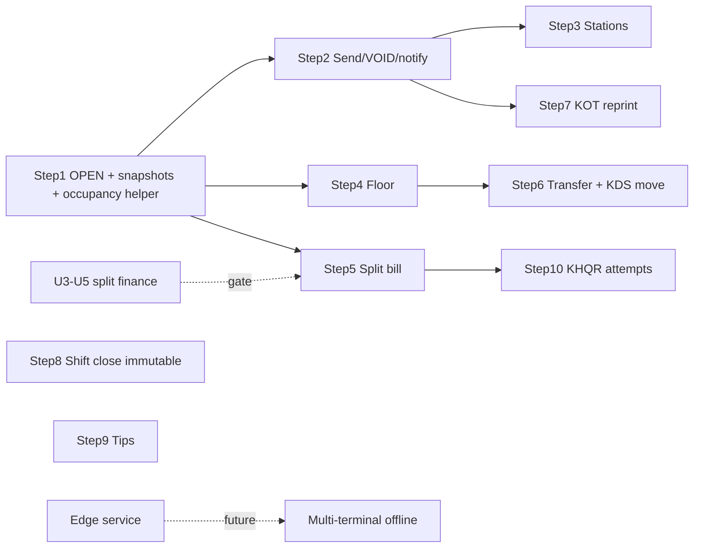

# POS Feature Gap and Priority (Revised — final corrections)

**Revision date:** 2026-11-20  
**Source of truth for lifecycles:** `POS-LIFECYCLE-AND-ARCHITECTURE.md`  
**Implementation sequence & Step 1 ACs:** `POS-IMPROVEMENT-PROPOSAL.md`  
**Git SHA:** unavailable in workspace · **Demo evidence date:** 2026-11-20

---

## Corrections reflected here

| Correction | Impact on gaps |
|---|---|
| Occupancy ≠ payment | Floor / `tableOccupancy` must use order status only; PAID does not free table |
| PaymentAttempt ≠ Order.paymentStatus | KHQR Step 10 adds attempt layer; order never FAILED from failed QR |
| Shift close by event shiftId | Step 8 formulas include PARTIALLY_PAID payments; refunds stay on refund shift |
| Split bill finance gate | Step 5 blocked until U3–U5 resolved in lifecycle §9 |
| Offline A vs B | Steps 1–8 assume **single-terminal** offline only |
| Void / transfer / reprint | Steps 2, 6, 7 must follow kitchen notify + send-batch snapshot rules |
| OPEN line snapshots | Step 1 freezes name/price/mod/station; catalog drift ignored |

---

## Classification legend

| Tag | Meaning |
|---|---|
| OK | Keep as-is |
| Incomplete | Exists but missing pieces |
| UX | Works but workflow weak |
| Missing | Not present |
| Skip | Not for Coffee Plus now |
| Gated | Design accepted; blocked on unresolved decisions |

---

## Matrix (selected)

| Feature | Status | Value | Complexity | Data impact | Offline | Regression | Priority step |
|---|---|---|---|---|---|---|---|
| Multi-tender one bill | OK | High | — | — | A only | — | Keep |
| PaymentAttempt vs order status | Missing | Critical | Med | Med | A | Med | with Step 10 (+ types earlier) |
| Split bill (items/equal/amount) | Missing / **Gated** | High (resto) | High | High | A | High | **Step 5** after U3–U5 |
| Multi-tender per split part | Missing / Gated | High | Med | Med | A | Med | with Step 5 |
| Persisted OPEN + line snapshots | Missing | Critical foundation | Med-High | High | A | High | **Step 1** |
| Occupancy independent of payment | UX/bug | Critical for floor | Low | Low | A | Low | Helper Step 1; UI Step 4 |
| Send before pay + batches | Missing | High (resto) | High | High | A | Med | **Step 2** |
| Kitchen void NEW/PREP/READY + notify | Incomplete | High | Med | Med | A | Med | **Step 2** |
| Prep stations config + snapshot | Missing | High multi-venue | Low-Med | Med | A | Low | **Step 3** |
| Floor board (persisted occupancy) | Missing | High | Med | Med | A | Low | **Step 4** |
| Table transfer + KDS table-change | Missing | Med | Low-Med | Low | A | Low | **Step 6** |
| Table merge | Missing | Med | High | High | A/B? | High | **Defer P2** |
| Kitchen ticket reprint from batch | Missing | Med-High | Low-Med | Low | A | Low | **Step 7** |
| Shift Closing Report (immutable) | Incomplete | High | Low-Med | Low | A | Low | **Step 8** |
| Tips | Missing | Med | Low | Low | A | Low | **Step 9** |
| KHQR confirm via PaymentAttempt | Missing | Critical KH | High | Med | Blocks offline | Med | **Step 10** |
| Multi-terminal offline shared orders | Missing | High later | Very High | High | **B needs edge** | High | **Not promised** |
| PIN login | Missing | Med | Med | Low | A | Low | Defer |
| Loyalty / gift / QR guest | Missing | Low now | High | High | — | — | **Skip** |
| POS GL / recipe stock ledger | Missing | Conflict w/ Sumady | — | — | — | — | **Skip forever** |
| EN/KH · USD/KHR · receipts · MockERP | OK | — | — | — | — | — | Protect |

**Offline column:** `A` = single-terminal localStorage OK · `B` = multi-terminal offline requires edge service (lifecycle §5).

---

## Dependency graph

**Rules:**  
- Do not start Steps 1, 5, and 10 in parallel.  
- Do not start Step 5 until U3–U5 closed.  
- Do not promise B without edge service.

---

## Unresolved decisions (from lifecycle §9)

| # | Topic | Blocks |
|---|---|---|
| U1 | HELD occupies table? | Floor semantics |
| U2 | Auto-complete when kitchen done + PAID? | Occupancy release |
| U3 | Split discount allocation basis | Step 5 |
| U4 | Custom amount gross vs net-of-tax | Step 5 |
| U5 | Allocate header tax vs recompute per part | Step 5 |
| U6 | Remove `FAILED` from order aggregate | Payment types |
| U7 | Payment row APPLIED vs PAID naming | Types |
| U8 | Multi-check per table v1 | Floor / transfer |
| U9 | Discount line on shift close attribution | Step 8 |
| U10 | Edge service timeline | Offline B |

---

## Observed vs claimed (references)

| Topic | Demo-observed | README-only |
|---|---|---|
| Adminium tips + fraction split UI | Yes (`05-…png`) | — |
| Adminium item-level split bill | Not verified | Not assumed |
| Adminium Send before pay | Register Send button observed (`02-…png`) | — |
| Adminium floor zones | Yes (`03-…png`) | — |
| Elitale full POS | No (PIN not completed; blush 503) | Features from README |
| Tavo offline outbox / Z-report | No live demo | README |
| POSR stations / fiscal | No deep demo this session | README / PSAL |
| OPEN-POS ESC/POS KOT | No desktop run | README / public domain |

---

## Cambodian fit (unchanged stance)

Keep EN/KH, USD/KHR, offline cash rules. Design KHQR as confirm-only via **PaymentAttempt**. Do not import GST/UPI/FBR. Do not duplicate Sumady inventory/GL. Single-terminal offline only until edge service exists.
