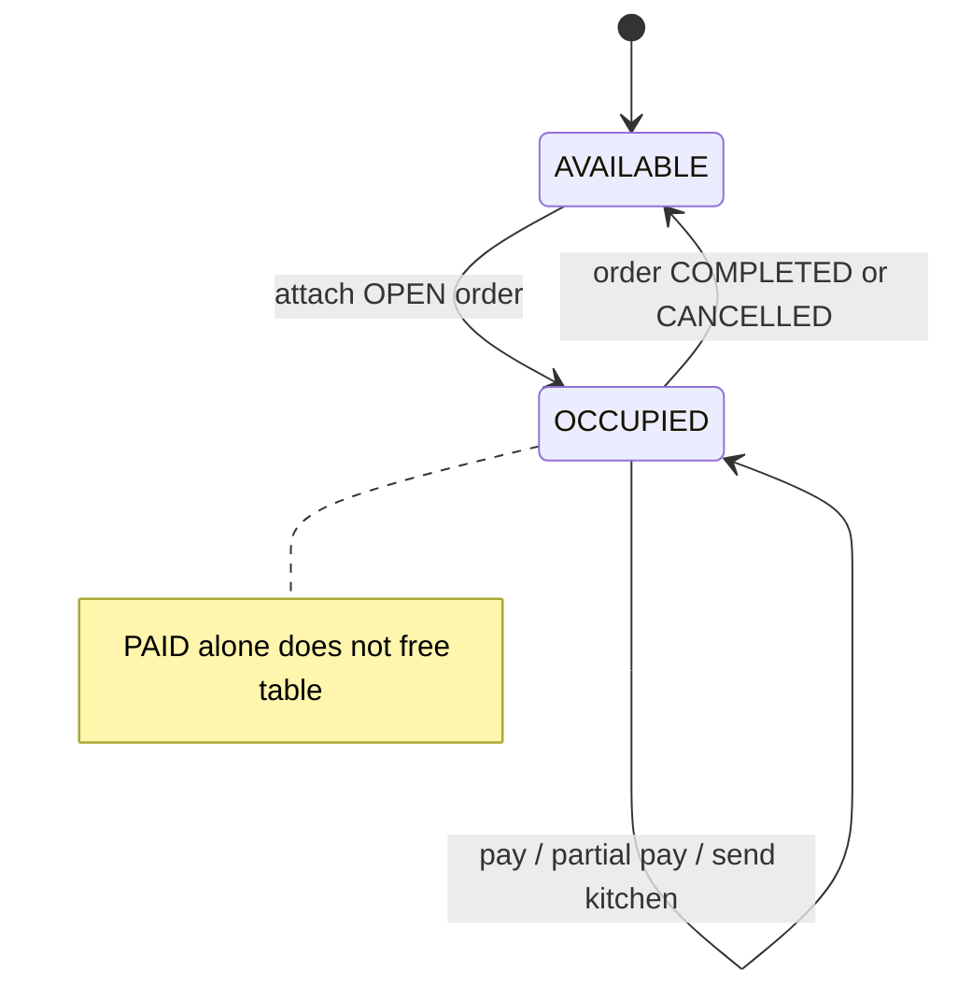
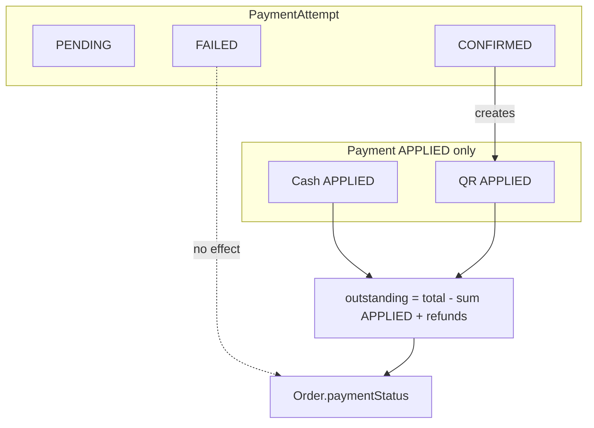
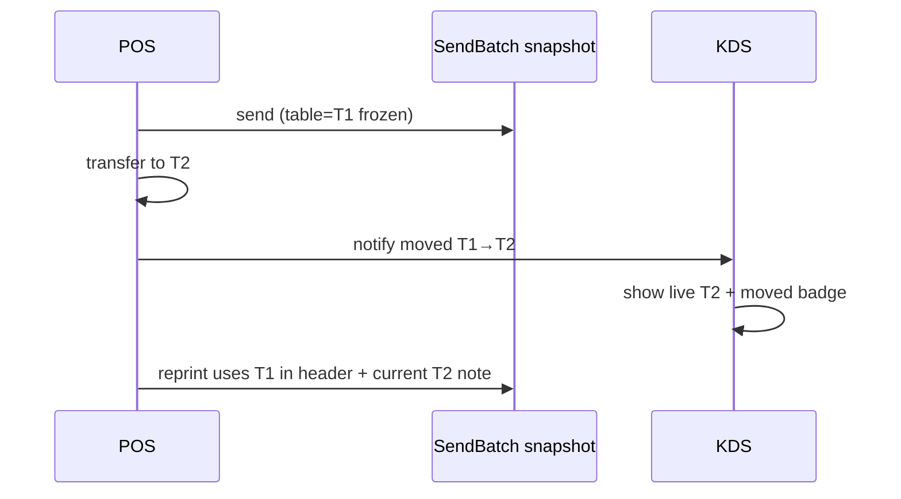
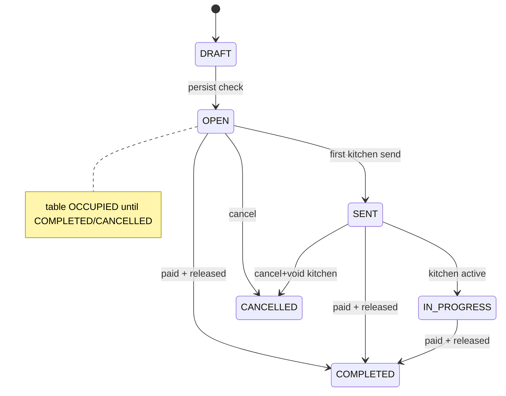
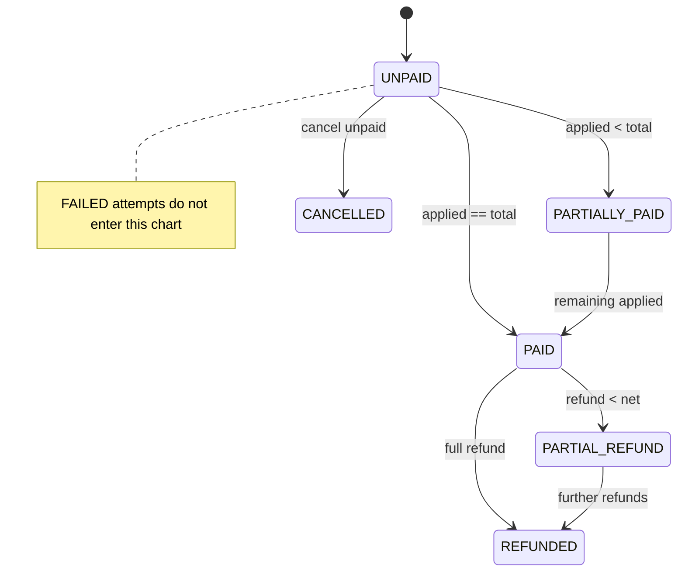

# Coffee Plus — Lifecycle & Architecture Revision

**Document type:** Design refinement (no implementation)  
**Research date:** 2026-11-20  
**Corrections revision:** 2026-11-20 (occupancy, payments, shift close, split bill finance, offline, void/transfer, OPEN snapshots)  
**Code inspected:** `pos-web/src/lib/domain/types.ts`, `reports.ts`, `order-payments.ts`  
**Git commit SHA:** *Unavailable* (no `.git` in workspace)  
**Screenshots:** `POS-REFERENCE-SCREENSHOTS/`

---

## 0. Current Coffee Plus (as coded) — baseline

| Dimension | Current values | Issue called out |
|---|---|---|
| `OrderStatus` | `HELD` · `CONFIRMED` · `COMPLETED` · `CANCELLED` | No OPEN / SENT |
| `PaymentStatus` (on **Order**) | `PENDING` · `PAID` · `FAILED` · `CANCELLED` · `REFUNDED` · `PARTIAL_REFUND` | Overloaded: order-level + attempt outcomes mixed; no `PARTIALLY_PAID` |
| `Payment.status` (on **Payment**) | same enum reused | Confuses attempt vs applied tender |
| `KitchenStatus` | `NEW` · `PREPARING` · `READY` · `COMPLETED` | No UNSENT / VOIDED |
| `tableOccupancy()` | `CONFIRMED` + `PAID` | **Wrong for floor** — frees table when still dining |
| Cart | Ephemeral until Hold/Pay | No persisted unpaid check |
| Multi-tender | Present | OK |
| Split bill | Missing | — |

---

## 1. Table occupancy (independent of payment)

### 1.1 Rule

**Occupancy is a service / seating state, not a payment state.**  
A table stays **OCCUPIED** while an active dining check is attached, including after full payment until the check is **completed / released**.

### 1.2 Occupancy matrix

| Situation | Order (conceptual) | Payment (order) | Table |
|---|---|---|---|
| OPEN unpaid | OPEN / SENT / IN_PROGRESS | UNPAID | **OCCUPIED** |
| Sent / preparing | SENT / IN_PROGRESS | any | **OCCUPIED** |
| Partially paid | OPEN…IN_PROGRESS | PARTIALLY_PAID | **OCCUPIED** |
| Fully paid, still dining / kitchen not done | IN_PROGRESS (or OPEN+PAID policy) | PAID | **OCCUPIED** |
| Completed / released | COMPLETED | PAID (or refunded closed) | **AVAILABLE** |
| Cancelled (no other active check) | CANCELLED | CANCELLED / UNPAID | **AVAILABLE** |
| Draft cart only (unsaved) | — | — | **AVAILABLE** (optional UI “draft” badge ≠ occupied) |

### 1.3 Derived occupancy query (proposed)

Table T is occupied iff there exists an order O where:

```
O.tableId == T.id
AND O.orderStatus ∈ { OPEN, SENT, IN_PROGRESS }
AND O.orderStatus ∉ { CANCELLED, COMPLETED, HELD? }
```

**HELD:** treat as **not occupying** a table unless product chooses “hold keeps table” (see unresolved decisions). Default: **HELD releases table**.

**Do not** use `paymentStatus` in the occupancy predicate.

### 1.4 Explicit release

Cashier (or auto-rule) sets order → `COMPLETED` when guests leave / kitchen cleared + policy satisfied → table AVAILABLE.  
Paying alone does **not** release the table.



---

## 2. Payment status layers (order ≠ payment ≠ attempt ≠ refund)

### 2.1 Three (plus refund) records

| Record | Purpose | Example statuses |
|---|---|---|
| **Order.paymentStatus** | Aggregate settlement of the **order** (or sum of bill parts) | `UNPAID` · `PARTIALLY_PAID` · `PAID` · `REFUNDED` · `PARTIAL_REFUND` · `CANCELLED` |
| **Payment** (applied tender) | Money **successfully applied** to order/part | `APPLIED` (or keep `PAID` meaning applied) · `REVERSED` (fully refunded) |
| **PaymentAttempt** | Provider/cashier try (esp. KHQR/card) | `PENDING` · `CONFIRMED` · `FAILED` · `EXPIRED` · `CANCELLED` |
| **RefundRecord** | Money returned | amount, method, `shiftId` at **refund time**, timestamps |

**Remove misuse:** Order must **not** become `FAILED` because one KHQR attempt failed.

### 2.2 Authoritative outstanding balance

```
applied = sum(Payment.amount where status = APPLIED)
refunded = sum(RefundRecord.amount)
netPaid = applied - refunded
outstanding = order.totals.total - netPaid   // or sum(part.outstanding) when split
```

- Only **APPLIED** payments count toward balance.  
- **FAILED / EXPIRED / CANCELLED attempts** never reduce outstanding.  
- Cash: `amountReceived` and `changeDue` are metadata; **applied** = `Payment.amount` (portion of order), not received.

### 2.3 Scenario: failed QR then cash

1. Attempt A: KHQR PENDING → FAILED. Order stays `UNPAID`.  
2. Payment B: CASH APPLIED for full total. Order → `PAID`.  
3. Attempt A remains FAILED in history; ignored by balance.

### 2.4 Mermaid



---

## 3. Cashier Shift Closing Report (corrected)

**Name:** Cashier Shift Closing Report — **not** a fiscal Z-report.

### 3.1 Transaction-level attribution

Every **Payment**, **RefundRecord**, and **cash movement** stores:

| Field | Role |
|---|---|
| `shiftId` | Shift **when the money moved** (sale apply or refund issue) |
| `branchId` | Branch |
| `terminalId` | Terminal |
| `staffId` | Actor |
| `timestamp` | Event time |
| `method` | CASH / CARD / QR / … |
| `appliedAmount` | Toward order (Payment.amount) |
| `cashReceived` | Cash drawer in (cash only) |
| `change` | Cash returned |
| `refundAmount` | On RefundRecord |

**Refund attribution:** `refund.shiftId` = shift **open when refund issued**, **not** the original sale’s shift.  
Original sale shift closing snapshot is **never rewritten**.

### 3.2 Include PARTIALLY_PAID

Closing math iterates **payment and refund rows** with `shiftId == thisShift`, not only fully PAID orders.

### 3.3 Formulas (drawer)

Let `P_s` = Payments APPLIED with `shiftId = S`.  
Let `R_s` = Refunds with `shiftId = S`.  
Let `M_in` / `M_out` = shift cash movements.

| Line | Formula |
|---|---|
| Opening cash | `shift.openingCash` |
| Cash received (drawer in from sales) | `sum(P_s.cashReceived)` for CASH |
| Cash applied to orders | `sum(P_s.appliedAmount)` for CASH |
| Change returned | `sum(P_s.change)` for CASH |
| **Net cash from sales into drawer** | `cashReceived - change` (= should equal cash applied if no tip-in-cash quirks) |
| Cash refunds (drawer out) | `sum(R_s.refundAmount)` where method CASH |
| Non-cash applied | `sum(P_s.appliedAmount)` non-cash methods (breakdown by method) |
| Non-cash refunds | `sum(R_s)` non-cash |
| Cash in / out | movements |
| **Expected drawer** | `opening + (cashReceived - change) - cashRefunds + cashIn - cashOut` |
| Counted | `countedCash` |
| Variance | `counted - expected` |
| Discounts | From orders whose **sale payments** in S (define: sum discount on orders that received ≥1 APPLIED payment in S — see unresolved) |
| Voids / cancels | Count events in S from timeline |
| Order count | Distinct orders with ≥1 APPLIED payment in S; plus cancel count |

**Anti double-count:** Never sum `order.totals.total` per order when multi-tender or split; always sum **payment rows**. Split bill: each part’s payments still unique rows.

### 3.4 Immutable closing snapshot

On close, persist `ShiftCloseSnapshot` with all report lines + hashed payment/refund id lists.  
Later refund in shift S2: appears only in S2 report; S1 snapshot unchanged.  
Corrections: **adjustment movement** or **new report addendum**, not silent rewrite of S1.

---

## 4. Split bill — financial rules (must be unambiguous before build)

### 4.1 Invariants

1. `sum(part.totals.total) == order.totals.total` (integer cents).  
2. Original `order.id` / `orderNumber` always on every part + receipt.  
3. Order remains one traceable header; parts are children.

### 4.2 Discount allocation

| Mode | Rule |
|---|---|
| ITEMS | Allocate order discount proportional to each part’s **pre-discount subtotal** share; remainder cents to last part. |
| EQUAL / AMOUNTS | Same proportion on pre-tax or post-discount basis — **choose one** (see unresolved: recommend **pre-discount subtotal**). |
| Line-level discounts (future) | Follow the line into the part that owns the line. |

### 4.3 Tax allocation

- Recompute tax **per part** from that part’s taxable amount using **order’s frozen** `taxRateBasisPoints` + `taxMode` (from order totals snapshot), **or** allocate header tax proportional to part taxable share with remainder on last part.  
- **Prefer:** proportional allocation of already-computed `order.totals.tax` so sum(parts.tax) == order.tax exactly.

### 4.4 Rounding

- All money in **integer cents**.  
- Any division: floor to N−1 parts, **last part absorbs remainder** so sums match header.

### 4.5 Fractional quantities (ITEMS)

- Prefer allocate in **integer quantity units** (e.g. 1 of 3 beers).  
- If fractional qty allowed: allocate **lineTotal cents** shares that sum to lineTotal; qty display may be fractional but cents are source of truth.

### 4.6 Equal split

- `N` parts; each gets `floor(total/N)`; last gets `total - sum(others)`.

### 4.7 Custom amounts

- User enters part totals (gross, including that part’s tax share) **or** enters pre-tax — **must pick one UX** (unresolved).  
- Validate `sum(amounts) == order.totals.total`.

### 4.8 Pay / refund per part

- Payments reference `billPartId`.  
- Part outstanding = part.total − sum(APPLIED to part) + refunds on part.  
- Order PARTIALLY_PAID while any part unpaid; PAID when all parts PAID.  
- Refunds reference part when split; shiftId = refund-time shift.

### 4.9 Historical receipts

- Each part payment can print a **part receipt** snapshot; order also keeps master snapshot.  
- Snapshots freeze names, prices, tax, discount shares, station — never live catalog.

**Gate:** Do **not** implement Step 5 until §4 decisions in §9 are resolved.

---

## 5. Offline scope

### 5.A Single-terminal offline (current demo class)

- One browser profile + `localStorage` blob.  
- OPEN/SEND/pay-cash/void locally OK under existing offline cash rules.  
- Non-cash attempts blocked or left PENDING until online (KHQR).  
- **In scope** for Steps 1–8 demo.

### 5.B Multi-terminal offline same branch

- **Not** provided by localStorage.  
- Concurrent OPEN orders / same table / send batches **will conflict** without shared authority.  
- **Do not promise** multi-terminal offline consistency in this proposal.

### 5.C Future edge-service dependency

```
Terminals → Branch Edge Service (authoritative orders, send batches, occupancy)
         → Sync → SumadyERPAdapter / cloud
```

Edge service owns: order ids, optimistic concurrency/version, table locks, outbox.  
Until then: document **single-terminal** only; multi-terminal requires online shared backend or edge.

---

## 6. Kitchen void & table transfer

### 6.1 Void after send

| Kitchen line state | Allowed? | Effect |
|---|---|---|
| NEW | Yes + manager | → VOIDED; KDS removes/greys; timeline `kitchen_void` |
| PREPARING | Yes + manager + reason | → VOIDED; **notify KDS** (flash/banner “VOID table X item”) |
| READY | Yes + manager + reason | → VOIDED; notify; do not serve |
| COMPLETED | No (or manager exception + waste note) | Prefer post-complete waste/refund path |
| UNSENT | Cancel line / delete — not kitchen void | |

Void never silently rewrites send batch history; batch retains voided line ids with status VOIDED.

### 6.2 Kitchen notification

- Real-time or poll: void event with `orderId`, `lineId`, `tableNameSnapshot`, `batchId`.  
- Terminal sound optional (reuse kitchen sound setting).

### 6.3 Table transfer after send

1. Update `order.tableId`.  
2. Append timeline `table_transfer` { from, to, staffId }.  
3. **Do not** mutate historical `KitchenSendBatch.tableName` snapshots.  
4. Emit **table-change notification** to KDS for open (non-void) lines: show current table from order + badge “Moved from T1→T2”.  
5. UI on KDS ticket: prefer **live order.table display name** for active tickets; reprint header uses policy below.

### 6.4 Reprint

- Reprint always loads **KitchenSendBatch** snapshot: line names, mods, qty, station, **table name at send time**, batch id, sentAt.  
- Optional footer: “Current table: {live}” if different from snapshot.  
- Never invent a new batch on reprint.



---

## 7. OPEN order snapshot & editing

### 7.1 Frozen at line add (or at first persist)

Per line snapshot fields (immutable for that line version):

- productId, erpItemId, sku  
- productName EN/KH  
- modifiers (ids + names + priceDelta)  
- baseUnitPrice, unitPrice, lineTotal (recomputed on qty change using frozen unit price)  
- preparesInKitchen, stationId + station name  
- tax category id used for pricing context  

Order header freeze on create/open: tax rate/mode name, fx rate (as today on pay — for OPEN, freeze at open or at first send; **recommend freeze tax/fx at OPEN create**).

### 7.2 Editable while OPEN (policy)

| Edit | Before any send | After some lines sent |
|---|---|---|
| Qty up on UNSENT line | Yes | Yes |
| Qty down / remove UNSENT | Yes | Yes |
| Qty on SENT line | No — void + add new line | void + add |
| Modifiers on SENT | No — void + new line | |
| Special instructions UNSENT | Yes | Yes |
| Discount header | Yes if unpaid/partial rules allow | Recompute parts if split exists |
| Table | Yes (transfer rules) | Yes + KDS notify |

### 7.3 Catalog drift

| Catalog change | Existing OPEN lines |
|---|---|
| Product price change | **Ignore** — keep snapshot unit price |
| Product archived | Lines remain; block **new** adds of that product |
| Modifier disabled | Existing snapshot kept; block selecting it on new lines |
| Station change on product | Existing line station snapshot unchanged |

### 7.4 After kitchen send

- New items = new lines UNSENT.  
- Sent lines only change via void workflow.  
- Price correctness of history preserved by snapshots + send batches.

---

## 8. Revised state diagrams (summary)

### Order + table



### Order.paymentStatus (aggregate only)



---

## 9. Unresolved decisions (block or choose before coding)

| # | Topic | Options | Blocks |
|---|---|---|---|
| U1 | HELD orders occupy table? | Default **no** | Floor |
| U2 | Auto-complete order when kitchen COMPLETED **and** PAID? | Auto vs manual release | Occupancy |
| U3 | Split: discount basis | Pre-discount subtotal vs post | Step 5 |
| U4 | Split: custom amount enters gross or net-of-tax? | Gross total vs pre-tax | Step 5 |
| U5 | Tax on parts | Allocate header tax vs recompute per part | Step 5 |
| U6 | Order.paymentStatus value `FAILED` | Remove from order aggregate; keep on attempts only | Payments refactor |
| U7 | Naming APPLIED vs PAID on Payment row | | Types |
| U8 | Multi-check per table | v1 forbid vs allow | Floor/transfer |
| U9 | Discount attribution on shift close | Orders touched by payments in shift vs proportional | Step 8 |
| U10 | Edge service timeline | When Sumady mandates multi-terminal | 5.B |

---

## 10. Protect Coffee Plus

No framework migration; preserve green UI, Paraglide, USD/KHR, receipt designer, MockERP→SumadyERP, no POS GL/inventory ledger. Documentation only in this pass.
